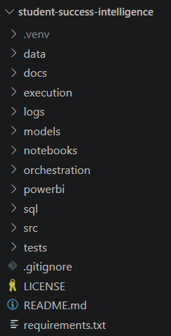

# Student Success Intelligence

### Predicción temprana de la deserción universitaria y el éxito académico

## 1. Problema de negocio

La deserción universitaria representa un desafío importante para las instituciones de educación superior.

Este proyecto tiene como objetivo desarrollar una solución integral de analítica y aprendizaje automático (*machine learning*) para identificar a los estudiantes en riesgo de abandonar sus estudios, monitorear su progreso académico y respaldar estrategias de retención estudiantil basadas en datos.

La solución explora modelos predictivos e indicadores de inteligencia académica para apoyar estrategias de intervención temprana.

## 2. Objetivos del proyecto

- Identificar factores académicos y socioeconómicos asociados a la deserción estudiantil.
- Desarrollar modelos predictivos de alerta temprana.
- Estimar las probabilidades de los resultados académicos de los estudiantes.
- Monitorear indicadores de éxito académico y deserción.
- Desarrollar paneles analíticos (*dashboards*) para la toma de decisiones.
- Construir un flujo de datos (*data pipeline*) reproducible y automatizado.

## 3. Fuente de datos

**Conjunto de datos:** Predicción de la deserción y el éxito académico de los estudiantes.

**Fuente original:** Repositorio de Aprendizaje Automático de la UCI (UCI Machine Learning Repository).

**Kaggle:** Predictores de retención estudiantil en educación superior.

- 4.424 registros de estudiantes.
- 36 variables predictoras.
- Tres categorías de resultados:
- Deserción (*Dropout*)
- Inscrito (*Enrolled*)
- Graduado (*Graduate*)

Cita del conjunto de datos:

Realinho, V., Vieira Martins, M., Machado, J., &
Baptista, L. (2021). Predict Students' Dropout and
Academic Success. UCI Machine Learning Repository.

https://doi.org/10.24432/C5MC89

Licencia: CC BY 4.0.

## 4. Stack tecnológico

| Tecnología | Propósito |
|---|---|
| Python | ETL y aprendizaje automático (*Machine Learning*) |
| Pandas / NumPy | Procesamiento de datos |
| Scikit-learn | Modelado predictivo |
| SQL Server | Almacén de datos (*Data Warehouse*) |
| SQL | Consultas analíticas e integridad de datos |
| Power BI | Inteligencia de negocios (*Business Intelligence*) |
| PBIP | Proyecto de BI con control de versiones |
| Git / GitHub | Control de versiones |

## 5. Arquitectura

El proyecto sigue la metodología CRISP-DM y una arquitectura de datos por capas. Datos brutos
↓
ETL en Python
↓
Validación de datos
↓
Área de preparación (Staging) en SQL Server
↓
Almacén de datos (Data Warehouse)
↓
Aprendizaje automático (Machine Learning)
↓
Predicciones y puntuaciones de riesgo
↓
Paneles de control en Power BI

## 6. Escenarios predictivos

### Escenario 1: Alerta temprana

Predicción basada en la información disponible al momento de la inscripción.

### Escenario 2: Progreso académico

Predicción actualizada basada en la información disponible tras
el primer semestre académico.

## 7. Estructura del proyecto

- data/: Capas de datos.
- notebooks/: Análisis exploratorio y experimentación.
- src/: Código fuente modular en Python.
- sql/: Scripts de base de datos y análisis.
- orchestration/: Orquestación del flujo de trabajo (pipeline).
- tests/: Pruebas automatizadas.
- docs/: Documentación técnica y de negocio.
- powerbi/: Proyecto de Power BI.

## 8. Estado del proyecto

Fase 1 - Configuración del repositorio y del proyecto.

## 9. Aviso legal

Este proyecto utiliza datos educativos públicos provenientes de una
institución de educación superior portuguesa. Se trata de un proyecto
analítico de portafolio.

Las predicciones tienen como fin servir de apoyo a la toma de decisiones,
y no constituyen juicios definitivos sobre los estudiantes de forma individual.