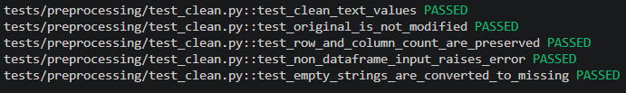

# Limpieza de datos

## 1. Objetivo

El objetivo de este módulo es aplicar transformaciones de limpieza básicas y no destructivas al conjunto de datos de estudiantes extraído, antes de proceder con el tratamiento de valores faltantes, la codificación y la ingeniería de características (*feature engineering*).

## 2. Módulo

`src/preprocessing/clean.py`

Función principal:

`clean_dataset(df: pd.DataFrame) -> pd.DataFrame`

## 3. Reglas de limpieza

| Regla | Descripción |
|---|---|
| Validación del DataFrame | Asegura que la entrada sea un DataFrame de pandas. |
| Copia del DataFrame | Crea una copia independiente para preservar el conjunto de datos original. |
| Normalización de texto | Elimina los espacios en blanco al inicio y al final de los valores de texto. |
| Manejo de cadenas vacías | Convierte las cadenas vacías y aquellas que solo contienen espacios en blanco en valores faltantes (`pd.NA`). |
| Preservación de datos | Mantiene el número original de filas y columnas. |

## 4. Transformaciones excluidas

El módulo no realiza las siguientes operaciones:

- Imputación de valores faltantes.
- Eliminación de registros duplicados.
- Codificación de variables categóricas.
- Escalado de variables numéricas.
- Ingeniería de características (*feature engineering*).
- Selección de características para modelos predictivos.

Estas transformaciones se gestionan mediante módulos de preprocesamiento independientes para mantener la modularidad y la trazabilidad.

## 5. Pruebas

Las pruebas automatizadas se encuentran implementadas en:

`tests/preprocessing/test_clean.py`

Ejecución:

```bash
python -m pytest tests/preprocessing/test_clean.py -v
```
ó para todas las pruebas de preprocessing

Ejecución:

```bash
python -m pytest tests/preprocessing/ -v
```

- -v: muestra las pruebas específicas aplicadas

Vista de las pruebas desde la terminal
---


## 6. Resultado

La función devuelve una copia limpia del DataFrame de entrada, sin modificar el objeto original.

El conjunto de datos resultante servirá como entrada para las etapas posteriores de preprocesamiento.