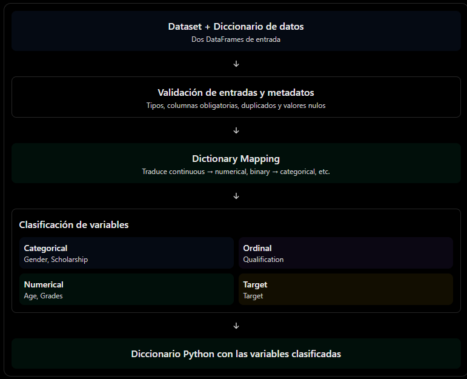
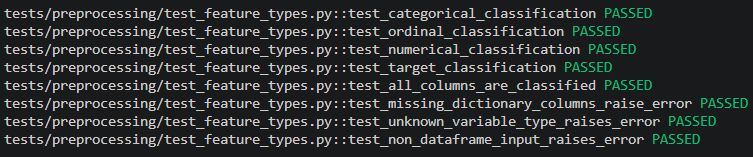

# Clasificación del tipo de variables

## 1. Objetivo

El objetivo de este módulo es clasificar las variables de un conjunto de datos según su naturaleza semántica y estadística, utilizando el diccionario de datos generado durante la etapa de comprensión de los datos (*Data Understanding*).

Esta clasificación evita que los tipos de almacenamiento numérico se interpreten erróneamente como variables numéricas continuas.

## 2. Módulo

`src/preprocessing/feature_types.py`

Función principal:

`classify_feature_types(df, dictionary)`

## 3. Grupos de variables

| `variable_type` en el diccionario | Grupo de variables |
|---|---|
| categorical | categorical |
| binary | categorical |
| ordinal | ordinal |
| continuous | numerical |
| integer | numerical |
| count | numerical |
| target | target |

## 4. Decisiones de diseño

- La clasificación de las variables se basa en los metadatos del diccionario de datos.
- Las variables categóricas codificadas como números enteros no se tratan automáticamente como variables numéricas continuas.
- Las variables ordinales se mantienen separadas para preservar su semántica de orden.
- Las variables binarias se agrupan junto con las variables categóricas.
- La variable objetivo (*target*) se separa explícitamente de las variables predictivas.

Flujo de clasificación del tipo de variables
---


## 5. Transformaciones excluidas

Este módulo no realiza:

- Codificación *One-Hot* (*One-Hot Encoding*).
- Codificación ordinal (*Ordinal Encoding*).
- Selección de variables (*Feature selection*).

Estas transformaciones se diseñarán en etapas posteriores.

## 6. Pruebas

Pruebas automatizadas:

`tests/preprocessing/test_feature_types.py`

Ejecución:

```bash
python -m pytest tests/preprocessing/test_feature_types.py -v
```



## 7. Resultado esperado

La función devuelve cuatro grupos:

- categorical
- ordinal
- numerical
- target

Estos grupos proporcionan los metadatos necesarios para las etapas posteriores de preprocesamiento y modelado predictivo.