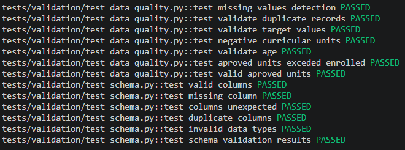

# Validación de datos

## 1. Visión general

Esta etapa evalúa la integridad estructural y la
calidad de los datos del conjunto de datos *Student Success Intelligence*.

El proceso de validación garantiza que el conjunto de datos
cumpla con los requisitos estructurales y lógicos predefinidos
antes de pasar a la etapa de preparación de datos.

## 2. Especificaciones del conjunto de datos

| Propiedad | Valor |
|---|---|
| Registros | 4.424 |
| Variables | 37 |
| Predictores | 36 |
| Variable objetivo | Target |
| Clases | Abandono (Dropout), Inscrito (Enrolled), Graduado (Graduate) |

## 3. Arquitectura

El proceso de validación consta de tres módulos principales.

### Validación del esquema

Fuente:

`src/validation/schema.py`

Valida:

- Columnas esperadas.
- Columnas faltantes o inesperadas.
- Nombres de columnas duplicados.
- Tipos de datos.
- Cantidad esperada de registros.

### Calidad de los datos

Fuente:

`src/validation/data_quality.py`

Valida:

- Valores faltantes.
- Registros duplicados.
- Categorías de la variable objetivo.
- Valores negativos en el recuento de unidades curriculares.
- Edad al momento de la inscripción.
- Unidades curriculares aprobadas frente a inscritas.

### Orquestador de validación

Fuente:

`src/validation/validate.py`

Coordina el proceso de validación, consolida
los resultados, calcula el estado general y
genera informes en formato CSV y JSON.

## 4. Ejecución

Ejecute el flujo de validación completo desde la
raíz del proyecto:

```bash
python -m src.validation.validate
```

## 5. Estado de la validación

| Estado | Descripción |
|---|---|
| PASS | Se han superado todas las comprobaciones de validación. |
| WARN | Se han identificado problemas no críticos. |
| FAIL | Se han incumplido requisitos de validación críticos. |

El flujo de validación se detiene si se detectan
errores críticos en el esquema.

## 6. Informes de validación

Los informes generados se almacenan en:

`docs/data/data_validation/reports/`

Formatos disponibles:

- CSV: resultados de la validación en formato tabular.
- JSON: resumen y resultados de la validación en formato estructurado. Los informes se generan con marcas de tiempo para preservar
el historial de las ejecuciones de validación.

Los informes generados están excluidos del control de versiones de Git.

## 7. Pruebas automatizadas

Las pruebas se implementan utilizando `pytest`.

Ejecución:

```bash
python -m pytest tests/validation/ -v
```

## 8. Pruebas automatizadas aprobadas




## 9. Principios de diseño del proyecto

- Separación de responsabilidades.
- Funciones de validación modulares.
- Lógica de validación reutilizable.
- Inspección de datos no destructiva.
- Pruebas automatizadas.
- Ejecución reproducible.
- Informes de validación estructurados.

## 10. Siguiente etapa

La siguiente etapa del proyecto se centra en la preparación de datos
y la ingeniería de características (*feature engineering*).

El conjunto de datos será depurado, transformado y
preparado para el modelado predictivo, manteniendo
la distinción entre la información disponible
en las diferentes etapas académicas.