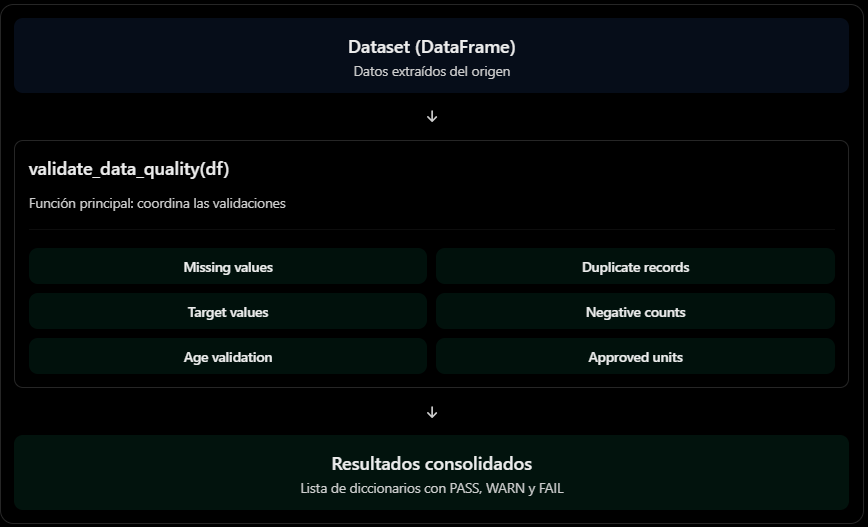

# Validación de la calidad de los datos

## 1. Descripción general

El módulo de calidad de los datos evalúa la consistencia
y la fiabilidad de los registros de un conjunto de datos.

Identifica valores faltantes, registros duplicados,
categorías objetivo no válidas, recuentos negativos de
unidades curriculares e inconsistencias lógicas.

## 2. Reglas de validación

| Regla | Gravedad | Descripción |
|---|---|---|
| Valores faltantes | ADVERTENCIA | Detecta valores nulos por columna. |
| Registros duplicados | ADVERTENCIA | Identifica filas completamente duplicadas. |
| Categorías objetivo | ERROR | Detecta clases objetivo inesperadas. |
| Unidades curriculares negativas | ERROR | Detecta recuentos académicos negativos. |
| Edad de inscripción | ERROR | Detecta edades que no son positivas. |
| Unidades aprobadas frente a inscritas | ERROR | Detecta unidades aprobadas que superan a las inscritas. |

## 3. Niveles de gravedad

### APROBADO (PASS)

Se ha cumplido la regla de validación.

### ADVERTENCIA (WARN)

Se ha identificado un posible problema de calidad de los datos.
El problema requiere análisis, pero no impide automáticamente
que continúe el procesamiento.

### ERROR (FAIL)

Se ha infringido una regla crítica de calidad de los datos.
El conjunto de datos requiere una investigación antes de continuar.

## 4. Implementación

Módulo fuente:

`src/validation/data_quality.py`

Función principal:

`validate_data_quality(df)`

Esta función ejecuta todas las comprobaciones de calidad de los datos
y devuelve una lista consolidada de resultados.

## 5. Consideraciones de diseño

- Los registros originales no se modifican.
- Los valores faltantes se notifican, no se imputan.
- Los registros duplicados se notifican, no se eliminan.
- Las categorías no válidas se tratan como errores críticos.
- Las comprobaciones numéricas requieren columnas de entrada numéricas.
- Los valores faltantes se excluyen de las comparaciones lógicas.

## 6. Flujo de ejecución

## 7. Siguiente etapa

Los resultados se integrarán en el flujo de trabajo (pipeline)
de validación centralizado.