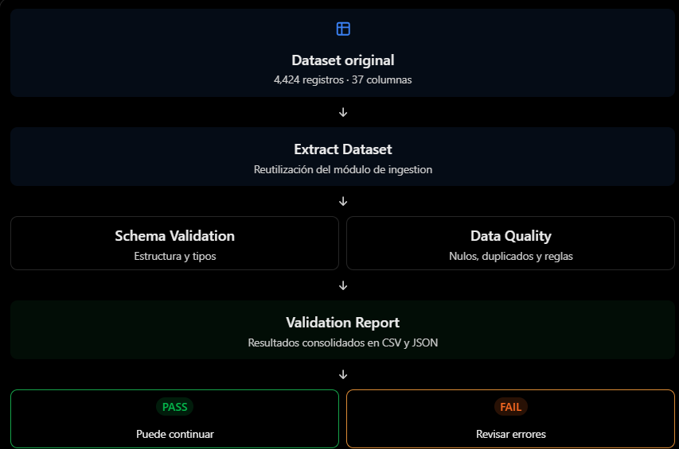

# Validación de esquema

## 1. Descripción general

El módulo de validación de esquema verifica que el
conjunto de datos cumpla con la definición estructural esperada
antes de pasar a las etapas posteriores de procesamiento de datos.

Garantiza que el conjunto de datos mantenga las
columnas, los tipos de datos y la coherencia estructural previstos.

## 2. Especificaciones del conjunto de datos

| Propiedad | Valor esperado |
|---|---|
| Registros en el conjunto de datos | 4.424 |
| Total de columnas | 37 |
| Variables predictoras | 36 |
| Variable objetivo | Target |
| Clases de la variable objetivo | Dropout, Enrolled, Graduate |

## 3. Reglas de validación

### 3.1 Validación de columnas

Comprueba que:

- Estén presentes todas las columnas esperadas.
- No se detecten columnas inesperadas.
- Los nombres de las columnas sean únicos.

### 3.2 Validación de tipos de datos

Comprueba que:

- Las variables predictoras utilicen tipos de datos numéricos.
- La variable objetivo utilice un tipo categórico o de cadena de texto (string).

### 3.3 Validación del recuento de filas

Compara el número real de registros con
el tamaño esperado del conjunto de datos.

Cualquier discrepancia genera una advertencia en lugar
de un fallo automático, lo que permite que futuras versiones
del conjunto de datos contengan registros adicionales.

## 4. Estado de la validación

| Estado | Significado |
|---|---|
| PASS | La validación se completó correctamente. |
| WARN | Se detectó una discrepancia no crítica. |
| FAIL | No se cumplió un requisito estructural. |

## 5. Implementación

Módulo de origen:

`src/validation/schema.py`

Función principal:

`validate_schema(df)`

Esta función consolida los resultados de todas
las comprobaciones de validación de esquema en una lista de diccionarios.

## 6. Consideraciones de diseño

- El conjunto de datos original no se modifica.
- La normalización de los nombres de las columnas se realiza durante la ingesta.
- La ausencia de columnas esperadas o la presencia de columnas inesperadas se consideran fallos.
- Las diferencias en el recuento de filas se tratan como advertencias.
- La validación de esquema es independiente de la limpieza de datos.

## 7. Flujo de ejecución

## 8. Etapa siguiente

La siguiente etapa de validación se centra en la calidad de los datos,
incluyendo valores faltantes, registros duplicados,
dominios categóricos y coherencia lógica.